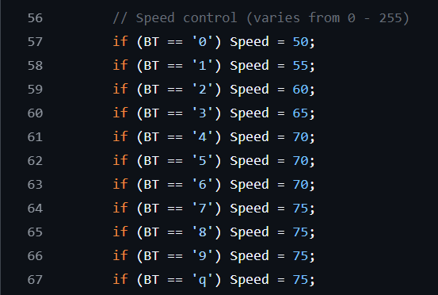

# Competition-Ready Robot Soccer Bot without requiring a transmitter.

- ✅ **Competition-Ready Design** – Built for robot soccer matches and intense gameplay.
- ⚡ **Powerful 37GB 555 DC Gear Motors (500–800 RPM)** – Deliver the perfect balance of speed and pushing power.
- 📱 **Bluetooth App Control** – Drive your bot directly from your Android device with responsive controls.
- 🎯 **Adjustable Speed Modes** – Fine-tune performance for aggressive attacks or precise ball control.
- 🔋 **ESP32 Powered** – Reliable, efficient, and highly responsive operation.
- 💰 **Budget-Friendly Alternative** – Enjoy competitive performance without investing in costly radio transmitters.

----

# Controller App for Android
Download this [apk](https://github.com/Fathin-Ishrak-Romeo/Soccer_Bot_for_Competition_without_any_Transmitter/blob/42f1ce6fa47a787dfee8adb81013b574e2b5375f/Android%20App%20(Bluetooth%20Car%20Controller).apk) & install this on your Android phone to control the soccerbot. 

# Variable Tuning
#### Initial Speed Setup
Set your bot's initial speed here in this code segment.
   

#### Defining Different Speed Modes & Top Speed
Set up your bot's speed modes & top speed here, according to your needs.
   

